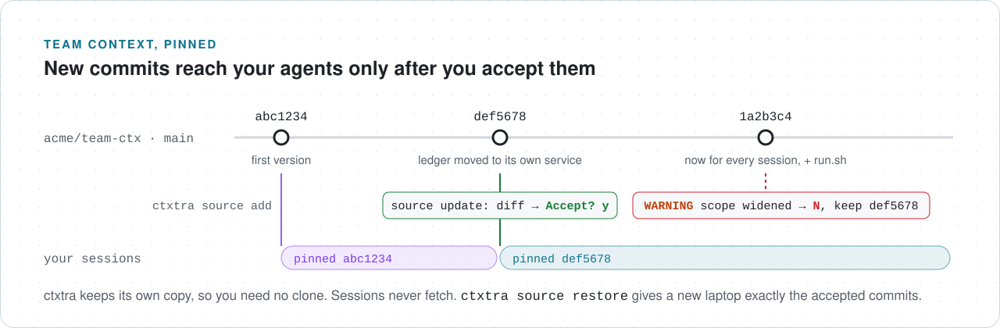

<p align="center">
  <picture>
    <source media="(prefers-color-scheme: dark)" srcset="docs/assets/hero-dark.svg">
    
  </picture>
</p>

> Alice works across dozens of repositories, spanning multiple projects and teams.
>
> Alice has built up a collection of instructions and skills for her AI agents. Some she needs in certain
> repositories, others in different ones, and a few everywhere.
>
> Bob likes some of Alice's workflows and wants to use them too. Maybe not all of them — he has his own
> preferences.
>
> Neither wants to impose their setup on the rest of the team, change the repositories they work on, or
> rearrange their directories just to make context inheritance work.
>
> They don't want to duplicate instructions across agents or rely on generators to keep them in sync.

Context isn't always global. It isn't always local. And it doesn't always belong in the codebase.

Let's add another layer.

```bash
brew install atelpis/tap/ctxtra
ctxtra onboard
```

ctxtra preloads instructions and makes skills available at session start, using bindings that match
folders or Git remotes. Bindings in `~/.config/ctxtra/config.yaml` can reference files in different
locations and sources, and the config can include separate binding files.

```yaml
schema: ctxtra/v1
bindings:
  - name: personal
    match:
      global: true  # Every session.
    instructions:
      - ~/dotfiles/agents/preferences.md
    skills:
      - ~/dev/review-tools/skills/review  # Contains SKILL.md.

  - name: work
    match:  # Any entry matches; dirs and repos are alternatives.
      dirs:
        # Matches session folders or the main checkout, including worktrees.
        - '~/dev/work/**'
      repos:
        # Any clone or worktree; SSH and HTTPS remotes both match.
        - github.com/acme/billing
        - 'github.com/acme/payments-*'  # Repo name prefix.
    instructions:
      - work/instructions.md  # Relative to this YAML file.
      - '~/docs/team/**/*.md'  # Markdown files, recursively.
    skills:
      - '~/dev/team-tools/skills/**'  # Skill folders, recursively.

  - name: billing-service
    match:
      repos:
        - remote: github.com/acme/mono
          subpath: services/billing/**  # Remote AND session subfolder.
    instructions:
      - /opt/agent-context/billing.md  # Absolute path.
      - ctxtra://team-ctx/billing.md  # From an added source.
    skills:
      - ctxtra://team-ctx/skills/billing  # Skills from that source too.
```

## Ask your agent to set it up

You don't have to learn ctxtra's config to get started — it comes with a skill that teaches your agents
to operate ctxtra. Install it during the interactive `ctxtra onboard` flow or later with
`ctxtra skill install ctxtra`.

<p align="center">
  <picture>
    <source media="(prefers-color-scheme: dark)" srcset="docs/assets/skill-chat-dark.svg">
    
  </picture>
</p>

## In context from the first message

A skill works only when the model decides it fits the task, and sometimes it doesn't. Rules that must
always apply belong in the context from the start. ctxtra adds your bound instructions when the session
starts, chosen by folder and repo, not by the model. Bound skills are listed next to them, for the tasks
that need them.

Only what you bind gets in. `ctxtra context show DIR` prints the exact text a session in `DIR` gets, and
`ctxtra context explain DIR` shows why each binding matched or didn't.

## Share packages with your team

<p align="center">
  <picture>
    <source media="(prefers-color-scheme: dark)" srcset="docs/assets/team-sync-dark.svg">
    
  </picture>
</p>

A package is a git repo of Markdown files and skills, with bindings that say where they go. The team writes
"billing.md goes to every session in github.com/acme/billing" once, and everyone who adds the package gets
it there, with no PRs to the billing repo:

```bash
ctxtra source add git git@github.com:acme/team-ctx.git --include bindings/billing.yaml
```

Each person stays at the commit they accepted, like a lockfile. `ctxtra source update` shows the diff of a new commit
and warns when a binding starts to match more sessions. A package's bindings can point only to its own
files, never to `~/.ssh` or anything else on your disk. Its text still goes to your agent, though, and
`ctxtra source add` accepts the current commit, so read a package before you add it, as you would read code before
you run it.

## Works with your agents

Claude Code · Codex CLI · GitHub Copilot CLI · Cursor (CLI and app) · OpenCode · Pi · Antigravity · Devin ·
Hermes Agent · Muse Code · DeepSeek Harness

Only use Claude Code? You still get instructions per repo that you don't commit, in every worktree, and skills
only in the repos that need them. Unlike a hook of your own that prints a file, ctxtra matches by git
remote, and `ctxtra context explain` says why a file is missing.

You keep running plain `claude` or `codex`.

## Quick start

Install with Homebrew on macOS or Linux:

```bash
brew install atelpis/tap/ctxtra
```

Or with Go 1.27+ (installs into `~/go/bin`):

```bash
go install github.com/atelpis/ctxtra/cmd/ctxtra@latest
```

Then run:

```bash
ctxtra onboard
```

Then open your agent in one of your repos and ask it, for example: "Use ctxtra to add an instruction file for this
repo to every session here." Or do it yourself, in the repo:

```bash
mkdir -p ~/agent-context && touch ~/agent-context/my-repo.md       # write your instructions for this repo in this file
ctxtra binding add my-repo --dir "$PWD" --instruction ~/agent-context/my-repo.md
ctxtra context explain    # what a session here gets, and why
```

The next session in this repo, or in any worktree of it, gets your instructions. To match every clone by its
remote instead, use `--repo github.com/you/my-repo`.

## Docs

- [Guide](docs/guide.md): every command, how each agent gets the text, and the limits.
- [Scenarios](docs/scenarios.md): step by step, from personal instructions to a team repo.
- [Config spec](docs/spec.md).

ctxtra is in preview, and the config format may still change. It runs on macOS and Linux. Changes are in
the [changelog](CHANGELOG.md); to contribute, see [CONTRIBUTING.md](CONTRIBUTING.md). MIT license.
