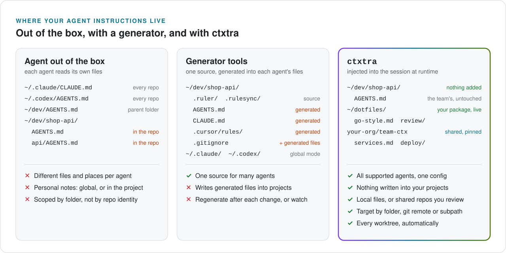

<p align="center">
  <picture>
    <source media="(prefers-color-scheme: dark)" srcset="docs/assets/hero-dark.svg">
    
  </picture>
</p>

<p align="center">
  <a href="https://github.com/atelpis/ctxtra/actions/workflows/ci.yml"></a>
  <a href="https://github.com/atelpis/ctxtra/actions/workflows/e2e.yml"></a>
  
  
</p>

Attach instructions and skills to a repo once, by its git remote. Every clone and every worktree of that repo
gets them, in every supported agent, including the worktree your agent created ten seconds ago. Your own notes
stay in your own folders, and your team's stay in a shared repo that you review.

`0 files written to your repo` · `0 setup steps per worktree` · `0 symlinks`

How it gets in: `ctxtra setup` adds one hook to each agent's user-level config, once. When a session starts,
the agent runs it, and ctxtra adds the files that match that session's folder and repo. You keep running plain
`claude`, `codex` or `opencode`.

<p align="center">
  
</p>

<p align="center">
  <picture>
    <source media="(prefers-color-scheme: dark)" srcset="docs/assets/compare-dark.svg">
    
  </picture>
</p>

## Yes, it's prompt injection

ctxtra adds text to your agent's context. That is the whole point. You choose the instructions and skills,
and which sessions get them. Team packages stay at the commit you accepted, and `ctxtra sync` shows changes
and warns when a binding widens its scope. `ctxtra show DIR` prints the rendered instructions. You control
what ctxtra adds and where; ctxtra doesn't make that content safe.

## Why ctxtra

- **Markdown packages, bound instead of installed.** A package is a folder or git repo of instruction files,
  skills and binding files (a `source` in the config). Use your own, your team's, or both. Bindings decide
  which sessions get which files: one file can go to many repos, and one repo can get files from many
  packages.
- **Worktrees just work.** Bindings by git remote or by the repository's main checkout match every linked
  worktree, wherever it is on disk: `~/wt/`, `.orca/`, or a folder an agent created a minute ago. There is no
  per-worktree step. Folder and `subpath` selectors can narrow a binding further, for example to one part of
  a monorepo.
- **Remote packages, pinned and reviewed.** A team's package is served from the commit you accepted. `ctxtra sync`
  shows the diff and warns when a binding widens its scope, and sessions never fetch. Bindings in a pinned
  package can reference only that package's own files, never `~/.ssh` or anything else on your disk.

<details>
<summary>Why not a symlink, an <code>@import</code> or <code>CLAUDE.local.md</code>?</summary>

- A symlink from `~/.codex/AGENTS.md` to `~/.claude/CLAUDE.md` keeps two agents in sync, but it is still
  global: every repository gets everything.
- `@import` is Claude Code syntax; the other agents don't read it. A `CLAUDE.md` in a parent folder like
  `~/dev` doesn't cover a worktree in `~/wt/` or `.orca/`.
- `CLAUDE.local.md` must exist in each checkout, so a new worktree starts without it. `.git/info/exclude` can
  hide local files in every worktree, but doesn't create or share them.

</details>

## Quick start

```bash
go install github.com/atelpis/ctxtra/cmd/ctxtra@latest
ctxtra setup --dry-run        # show which agent configs would change
ctxtra setup                  # add the hook to every agent found on this machine
```

Your package can be any folder or git repo of your own, for example your dotfiles. Put a binding file in it,
`~/dev/dotfiles/ctxtra/bindings.yaml`:

```yaml
apiVersion: ctxtra/v1alpha1
kind: Binding
metadata:
  name: go
spec:
  selector:
    dirs:
      - ~/dev/**                           # every repo under ~/dev, and all their worktrees
    gitRepos:
      - remote: github.com/acme/**         # and every acme repo, wherever it is cloned
  files:
    - ../go-style.md                       # relative to this file
  skills:
    - ../skills/review                     # a folder with a SKILL.md
```

```text
$ ctxtra add --trust ~/dev/dotfiles/ctxtra/bindings.yaml
created ~/.config/ctxtra/config.yaml
added source dotfiles (trusted-path: ~/dev/dotfiles); changes apply right away
added ctxtra://dotfiles/ctxtra/bindings.yaml
  binding go: for ~/dev/**, github.com/acme/**
    files: ~/dev/dotfiles/go-style.md
    skills: ~/dev/dotfiles/skills/review

$ cd ~/dev/acme/billing && claude
ctxtra: added 1 file (go-style.md) and 1 skill (review)
```

`--trust` tells ctxtra the repo is yours, so it reads it from disk and an edit reaches the next session. Commit
and push the package like any other repo. `config.yaml` lists your packages and binding files; `ctxtra add`
writes it.

Already have notes in `~/.claude/CLAUDE.md` and `~/.codex/AGENTS.md`? Move them into one file, bind it with
`global: true` (see the setup below), and empty the old files so the text isn't added twice.

<details>
<summary>The setup behind the pictures: a personal package and a team package</summary>

`~/.config/ctxtra/config.yaml` declares the two packages and which of their binding files you use:

```yaml
apiVersion: ctxtra/v1alpha1
kind: Config
sources:
  dotfiles:
    trusted-path: ~/dev/dotfiles           # yours: read from disk, edits apply right away
  team-ctx:
    git: git@github.com:acme/team-ctx.git  # the team's: ctxtra keeps its own copy
    branch: main
    commit: '...'                          # the full commit ID you accepted; add and sync write it
bindings:
  - ctxtra://dotfiles/ctxtra/bindings.yaml
  - ctxtra://team-ctx/bindings/billing.yaml
```

`ctxtra/bindings.yaml` in your dotfiles:

```yaml
apiVersion: ctxtra/v1alpha1
kind: Binding
metadata:
  name: me
spec:
  selector:
    global: true                           # every session
  files:
    - ../me.md                             # relative to this file
---
apiVersion: ctxtra/v1alpha1
kind: Binding
metadata:
  name: go
spec:
  selector:
    dirs:
      - ~/dev/**                           # also worktrees of repos under ~/dev, wherever they are
  files:
    - ../go-style.md
```

`bindings/billing.yaml` in the team's package:

```yaml
apiVersion: ctxtra/v1alpha1
kind: Binding
metadata:
  name: billing
spec:
  selector:
    gitRepos:
      - remote: github.com/acme/billing
  files:
    - ../billing.md
  skills:
    - ../skills/deploy
```

</details>

<details>
<summary>All selectors</summary>

A binding applies when any entry of its selector matches the folder the session starts in.

| Selector | Matches |
|---|---|
| `global: true` | Every session. |
| `dirs: [~/dev/work/**]` | The session folder, or the main checkout of its repository, so worktrees match wherever they are. |
| `gitRepos: [{remote: github.com/acme/**}]` | Any clone with a matching remote, and its worktrees. `git@` and `https://` forms are the same. |
| `gitRepos: [{remote: github.com/acme/mono, subpath: services/billing/**}]` | One part of a monorepo. |

Files are plain Markdown, and skills are folders with a `SKILL.md`, the format the agents already use.
Nothing in them is specific to ctxtra.

</details>

## Supported agents

More are coming: an agent is one small package behind the `agent.Agent` interface. Supported today:

| Agent | Runs as | Files go to | Skills | Summary at start | Subagents | e2e tested |
|---|---|---|---|---|---|---|
| Claude Code | hook | session context | listed, read when needed | yes | yes | yes |
| Codex CLI | hook (trust once with `/hooks`) | session context | listed, read when needed | yes | yes | yes |
| Pi | extension | context files | native skills | yes | (none in Pi) | yes |
| OpenCode 2 | plugin | system prompt | native skills | no | yes | yes |
| Cursor Agent CLI | hook | session context | listed, read when needed | no | no | no |

The e2e suite runs the real agent binaries against a mock model that records every request, and checks
what reaches the model. A nightly job runs it against the latest agent releases.

`setup` changes only its own entries in the agents' user-level configs and backs up each file to
`~/.ctxtra/backups`. `ctxtra setup --remove` removes them.

## See exactly what the agent gets

```text
$ ctxtra explain ~/dev/side-project
...
+ me (~/dev/dotfiles/ctxtra/bindings.yaml): global
    file     ~/dev/dotfiles/me.md (83 chars)
+ go (~/dev/dotfiles/ctxtra/bindings.yaml): dirs ~/dev/** matches ~/dev/side-project
    file     ~/dev/dotfiles/go-style.md (95 chars)
- billing (~/.ctxtra/store/.../bindings/billing.yaml): gitRepos: not in a git repository

total: 2 files, 0 skills, 737 chars (about 184 tokens)
```

The total counts the whole text the agent gets, with the header ctxtra puts before each file.

Claude Code, and Codex by default, show the model only a preview of hook output above about 10,000
characters. `explain` and `doctor` warn above that, and `budget.maxChars` in the config drops whole files
from the end until the text fits.

<details>
<summary>All inspect commands</summary>

| Command | Shows |
|---|---|
| `ctxtra files [DIR]` | The files and skills a session in DIR gets. |
| `ctxtra show [DIR]` | The exact text the agent gets. |
| `ctxtra explain [DIR]` | Every binding: matched or not, and why. |
| `ctxtra doctor [DIR]` | Config problems, setup state, Codex trust, recent hook runs. |

Every hook run is logged to `~/.ctxtra/log.jsonl`. The hook never breaks a session: a broken binding or a
missing file is skipped and reported, and on any other error the hook adds nothing and logs the error.

</details>

## Share a package with your team

<p align="center">
  <picture>
    <source media="(prefers-color-scheme: dark)" srcset="docs/assets/team-sync-dark.svg">
    
  </picture>
</p>

A team keeps its service notes, conventions, skills and default bindings in one repository. You add it by
URL, and ctxtra keeps its own copy and serves the commit you accepted, like a lockfile for prompts. A new
commit reaches your sessions after `ctxtra sync` shows you the diff and you accept it.

```text
$ ctxtra add git@github.com:acme/team-ctx.git bindings/billing.yaml
fetched team-ctx: main at abc1234 (git@github.com:acme/team-ctx.git)
added source team-ctx (pinned: changes apply after `ctxtra sync`)
added ctxtra://team-ctx/bindings/billing.yaml
...

$ ctxtra sync                 # later: you already accepted def5678, and the team pushed 1a2b3c4
team-ctx: def5678 -> 1a2b3c4 (main, git@github.com:acme/team-ctx.git)
WARNING: binding billing in bindings/billing.yaml now applies to every session (was: github.com/acme/billing)
diff --git a/bindings/billing.yaml b/bindings/billing.yaml
...
Accept? [y/N] N
not accepted; you keep def5678
```

- Use the bindings the package ships, or leave them out and bind its files your own way:
  `ctxtra://team-ctx/billing.md` works in your own binding files.
- A team repository can reference only its own files: never `~/.ssh`, never a path outside it. It can't
  declare sources, and its git hooks, submodules and symlinks are never used. A skill can still contain
  scripts that the agent may run, so review skills like code.
- The review shows in full every file you use. Other changed files are listed by name (`--full` shows them),
  and accepting a commit accepts all of them.
- The first version is accepted when you add it, the same decision as cloning. Read the repository first.
- A new laptop gets exactly the accepted commits with `ctxtra sync --restore`.

## Trust

ctxtra adds text to your agent's context, so it reads a file from disk only when the file is yours:

- Outside git, or in a repository without a remote: read.
- In a repository with a remote: read only if you add the repository as a trusted source
  (`ctxtra add --trust ~/dev/dotfiles`). Otherwise the file is skipped, and `doctor` says how to trust it or
  pin it.
- A team repository: read from ctxtra's copy of the commit you accepted.

ctxtra doesn't check what the files say. An instruction file is acted on like anything you type to the
agent: bind only files you wrote or reviewed.

## How it's built

- **One binary, many agent formats.** `setup` adds session-start and subagent-start hooks (Claude Code,
  Codex), a session-start hook (Cursor), or a small extension that runs the binary (Pi, OpenCode). Each
  agent is one package behind the `agent.Agent` interface; adding an agent means implementing it.
- **Trust per repository.** A binding file in someone else's repository could add any file on your disk to
  a session. Folders are compared as folders, not as text, so symlinks, case-insensitive disks and nested
  repositories can't get around the check, which reads `.git` and the git config directly, without running
  git.
- **Git with the sharp edges removed.** Pinned sources are fetched into a bare repository: no checkout, no
  hooks, no submodules, no LFS filters, no textconv. Paths are checked for case and Unicode collisions,
  sizes are limited, and control characters in diffs are escaped.
- **Config edits that keep your file.** `add` and `sync` edit your YAML as text and keep comments, validate
  the result, write it atomically with a backup, and accept nothing if that source changed in the config
  during the review.
- **Contract tests against real agents**, as above, with pinned agent versions and a nightly run on the
  latest ones.

Details: [docs/spec.md](docs/spec.md).

<details>
<summary><b>Limits</b></summary>

- In Claude Code, Codex and Cursor, resumed sessions don't get the text again, because the transcript
  already has it. In Claude Code and Codex, `/compact` and `/clear` add it again. Pi and OpenCode add the
  text to the system prompt of every request, so resumed sessions get it too.
- A subagent gets the files when it starts, so it can see a newer version than its parent.
- Codex asks you to trust a hook again after every change to it, for example after the binary moved.
  `doctor` shows whether a trust record exists.
- OpenCode: only OpenCode 2 (tested with 2.0.29).
- `setup` follows `CLAUDE_CONFIG_DIR`, `CODEX_HOME` and `XDG_CONFIG_HOME` when they are set.
- macOS and Linux. Windows isn't supported yet.
- ctxtra manages Markdown context and skills only: no MCP servers, permissions, commands or registries.

</details>

## Docs

- [docs/scenarios.md](docs/scenarios.md): use cases step by step, from your own notes to a team repository you
  contribute to, with the commands and what they print.
- [docs/spec.md](docs/spec.md): the full config spec.

**Status: preview.** The config format (`ctxtra/v1alpha1`) may still change.

## Development

```bash
go test ./...                       # unit and CLI tests; the Pi and OpenCode tests also need node
cd e2e && go test -count=1 ./...    # real agents against a mock model; see e2e/README.md
```
