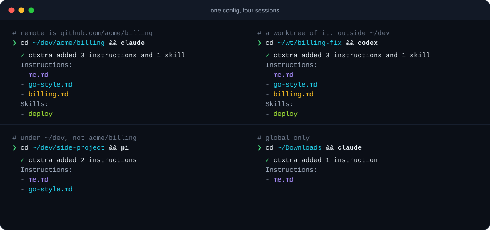

<p align="center">
  <picture>
    <source media="(prefers-color-scheme: dark)" srcset="docs/assets/hero-dark.svg">
    
  </picture>
</p>

<p align="center">
  <a href="https://github.com/atelpis/ctxtra/actions/workflows/ci.yml"></a>
  <a href="https://github.com/atelpis/ctxtra/actions/workflows/e2e.yml"></a>
  
  
</p>

Attach instructions and skills to a repo once, by its git remote. Every clone and every worktree of that repo
gets them, in every supported agent, including the worktree your agent created ten seconds ago. Your own notes
stay in your own folders, and your team's stay in a shared repo that you review.

`0 files written to your repo` · `0 setup steps per worktree` · `0 symlinks`

How it gets in: `ctxtra setup` adds a hook, or a small plugin, to each agent's user-level config, once. When a
session starts, the agent runs it, and ctxtra adds the files that match that session's folder and repo. You keep
running plain `claude`, `codex`, `copilot` or `opencode`.

<p align="center">
  <picture>
    <source media="(prefers-color-scheme: dark)" srcset="docs/assets/story-dark.svg">
    
  </picture>
</p>

<p align="center">
  
</p>

## Yes, it's prompt injection

ctxtra adds text to your agent's context. That is the whole point. You choose the instructions and skills,
and which sessions get them. Team packages stay at the commit you accepted, and `ctxtra sync` shows changes
and warns when a binding widens its scope. `ctxtra show DIR` prints the rendered instructions. You control
what ctxtra adds and where; ctxtra doesn't make that content safe.

## Why ctxtra

- **Markdown packages, bound instead of installed.** A package is a folder or git repo of instruction files,
  skills and binding files (a `source` in the config). Use your own, your team's, or both. Bindings decide
  which sessions get which files: one file can go to many repos, and one repo can get files from many
  packages.
- **Worktrees just work.** Bindings by git remote or by the repository's main checkout match every linked
  worktree, wherever it is on disk: `~/wt/`, `.orca/`, or a folder an agent created a minute ago. There is no
  per-worktree step. A `subpath` narrows a binding to one part of a monorepo.
- **Remote packages, pinned and reviewed.** A team's package is served from the commit you accepted. `ctxtra sync`
  shows the diff and warns when a binding widens its scope, and sessions never fetch. Bindings in a pinned
  package can reference only that package's own files, never `~/.ssh` or anything else on your disk.
- **Your agent can set it up.** `ctxtra skill install` adds a skill that teaches agents ctxtra's commands.
  Ask "add my Go notes to every session in my work repos". The agent asks you before each change, and never
  trusts a repository or accepts a team update for you.
- **Your existing files, moved in once.** `setup` finds the instruction files your agents already have,
  `~/.claude/CLAUDE.md`, `~/.codex/AGENTS.md` and the others, and offers to merge them into one file that
  every agent gets.

<details>
<summary>Why not a symlink, an <code>@import</code> or <code>CLAUDE.local.md</code>?</summary>

- A symlink from `~/.codex/AGENTS.md` to `~/.claude/CLAUDE.md` keeps two agents in sync, but it is still
  global: every repository gets everything.
- `@import` is Claude Code syntax; the other agents don't read it. A `CLAUDE.md` in a parent folder like
  `~/dev` doesn't cover a worktree in `~/wt/` or `.orca/`.
- `CLAUDE.local.md` must exist in each checkout, so a new worktree starts without it. `.git/info/exclude` can
  hide local files in every worktree, but doesn't create or share them.

</details>

## Quick start

```bash
go install github.com/atelpis/ctxtra/cmd/ctxtra@latest
ctxtra setup --dry-run        # show which agent configs would change
ctxtra setup                  # add the hook to every agent found on this machine
```

Bind a file to every session:

```text
$ ctxtra bind me --global --file ~/notes/me.md
created ~/.config/ctxtra/config.yaml
added binding me to ~/.config/ctxtra/config.yaml: for every session
  instructions: ~/notes/me.md
```

Keep your notes in a git repo, for example your dotfiles? Tell ctxtra the repo is yours, then bind by folder
and by remote:

```text
$ ctxtra add --trust ~/dev/dotfiles
added source dotfiles (trusted-path: ~/dev/dotfiles); changes apply right away

$ ctxtra bind go --dir '~/dev/**' --repo 'github.com/acme/**' \
    --file ~/dev/dotfiles/go-style.md --skill ~/dev/dotfiles/skills/review
added binding go to ~/.config/ctxtra/config.yaml: for ~/dev/**, github.com/acme/**
  instructions: ~/dev/dotfiles/go-style.md
  skills: ~/dev/dotfiles/skills/review

$ cd ~/dev/acme/billing && claude
✓ ctxtra added 2 instructions and 1 skill
Instructions:
- me.md
- go-style.md
Skills:
- review
```

`--trust` makes ctxtra read the repo from disk, so an edit reaches the next session. `bind` writes the binding
only when a session would get every file in it: a file in someone else's repository is refused until you
trust it or pin it. The config is plain YAML, so you can edit it by hand too:

```yaml
schema: ctxtra/v1
bindings:
  - name: me
    match:
      global: true
    instructions:
      - ~/notes/me.md
  - name: go
    match:
      dirs:
        - ~/dev/**                         # every repo under ~/dev, and all their worktrees
      repos:
        - github.com/acme/**               # and every acme repo, wherever it is cloned
    instructions:
      - ~/dev/dotfiles/go-style.md
    skills:
      - ~/dev/dotfiles/skills/review       # a folder with a SKILL.md
sources:
  dotfiles:
    trusted-path: ~/dev/dotfiles
```

Or let an agent do it: `ctxtra skill install` adds the ctxtra skill to every session (`setup` offers it too),
and then you can ask any agent, for example "add my notes to every session in my work repositories".

Already have notes in `~/.claude/CLAUDE.md`, `~/.codex/AGENTS.md` or another agent's own files? `setup`
offers to move them into ctxtra: it backs them up and starts an agent that merges them into one file, asks
you about rules that fit only one agent, and binds the result. It removes the old copies only if you agree.
`ctxtra import` makes the same offer later.

<details>
<summary>The setup behind the pictures: a personal package and a team package</summary>

`~/.config/ctxtra/config.yaml` declares the two packages, your own bindings, and the team's binding file:

```yaml
schema: ctxtra/v1
sources:
  dotfiles:
    trusted-path: ~/dev/dotfiles           # yours: read from disk, edits apply right away
  team-ctx:
    git: git@github.com:acme/team-ctx.git  # the team's: ctxtra keeps its own copy
    branch: main
    commit: '...'                          # the full commit ID you accepted; add and sync write it
bindings:
  - name: me
    match:
      global: true                         # every session
    instructions:
      - ~/dev/dotfiles/me.md
  - name: go
    match:
      dirs:
        - ~/dev/**                         # also worktrees of repos under ~/dev, wherever they are
    instructions:
      - ~/dev/dotfiles/go-style.md
include:
  - ctxtra://team-ctx/bindings/billing.yaml
```

`bindings/billing.yaml` in the team's package:

```yaml
schema: ctxtra/v1
bindings:
  - name: billing
    match:
      repos:
        - github.com/acme/billing
    instructions:
      - ../billing.md                      # relative to this file
    skills:
      - ../skills/deploy
```

Your own binding files can live in your dotfiles too: `include` them like the team's.

</details>

<details>
<summary>All match keys</summary>

A binding applies when any entry of its `match` block matches the folder the session starts in.

| Key | Matches |
|---|---|
| `global: true` | Every session. |
| `dirs: [~/dev/work/**]` | The session folder, or the main checkout of its repository, so worktrees match wherever they are. |
| `repos: [github.com/acme/**]` | Any clone with a matching remote, and its worktrees. `git@` and `https://` forms are the same. |
| `repos: [{remote: github.com/acme/mono, subpath: services/billing/**}]` | One part of a monorepo. |

`instructions` and `skills` take globs too: `'~/notes/**/*.md'` binds every note, and `skills/**` every
folder with a `SKILL.md`.

Files are plain Markdown, and skills are folders with a `SKILL.md`, the format the agents already use.
Nothing in them is specific to ctxtra.

</details>

## Supported agents

More are coming: an agent is one small package behind the `agent.Agent` interface. Supported today:

| Agent | Runs as | Files go to | Skills | Summary at start | Subagents | e2e tested |
|---|---|---|---|---|---|---|
| Claude Code | hook | session context | listed, read when needed | yes | yes | yes |
| Codex CLI | hook (trust once with `/hooks`) | session context | listed, read when needed | yes | yes | yes |
| GitHub Copilot CLI | hook | session context | listed, read when needed | no | yes | yes |
| Pi | extension | context files | native skills | yes | (none in Pi) | yes |
| OpenCode 2 | plugin | system prompt | native skills | no | yes | yes |
| Muse Code | hook | session context | listed, read when needed | yes | yes | yes |
| Antigravity (CLI, App, IDE) | hook | session context | listed, read when needed | no | yes | CLI |
| Hermes Agent | plugin (enable once) | first message | listed, read when needed | no | yes | yes |
| DeepSeek Harness (dsh) | plugin | context, after the first prompt | listed, read when needed | no | yes | yes |
| Cursor Agent CLI | hook | session context | listed, read when needed | no | no | no |
| Devin (CLI, Desktop) | hook | session context | listed, read when needed | no | no | no |

The e2e suite runs the real agent binaries against a mock model that records every request, and checks
what reaches the model. A nightly job runs it against the latest agent releases.

`setup` changes only its own entries in the agents' user-level configs and backs up each file to
`~/.ctxtra/backups`. `ctxtra setup --remove` removes them. Codex runs the hook after you trust it once
(`/hooks`), and Hermes loads the plugin after `hermes plugins enable ctxtra`. An upgrade doesn't need
`setup` again, unless the release notes say so. When an agent's setup needs you, every ctxtra command says
so, with the command that fixes it.

## See exactly what the agent gets

```text
$ ctxtra explain ~/dev/side-project
...
+ me (~/.config/ctxtra/config.yaml): global
    file     ~/dev/dotfiles/me.md (50 chars)
+ go (~/.config/ctxtra/config.yaml): dirs ~/dev/** matches ~/dev/side-project
    file     ~/dev/dotfiles/go-style.md (63 chars)
- billing (~/.ctxtra/store/.../bindings/billing.yaml): repos: not in a git repository

total: 2 files, 0 skills, 650 chars (about 162 tokens)
```

The total counts the whole text the agent gets, with the header ctxtra puts before each file.

Large texts arrive in full: 360,000 characters in Claude Code, and more in most other agents. Where an agent
cuts a large hook output, ctxtra splits the text into labeled parts. Above an agent's limit, or the
`budget.max-chars` you set, whole files are dropped from the end, and `explain` names them.

<details>
<summary>All inspect commands</summary>

| Command | Shows |
|---|---|
| `ctxtra files [DIR]` | The files and skills a session in DIR gets. |
| `ctxtra show [DIR]` | The exact text the agent gets. `--session FOLDER`: only what DIR adds to a session in FOLDER. |
| `ctxtra explain [DIR]` | Every binding: matched or not, and why. |
| `ctxtra doctor [DIR]` | Config problems, setup state, Codex trust, recent hook runs. |

Every hook run is logged to `~/.ctxtra/log.jsonl`. The hook never breaks a session: a broken binding or a
missing file is skipped and reported, and on any other error the hook adds nothing and logs the error.

</details>

## When the agent moves to another repo

A session gets what its start folder matches. Ask the agent to "also update the client in ../billing", and
your billing bindings don't reach it. The optional `ctxtra-follow` skill handles this (`setup` offers it):

```bash
ctxtra skill install ctxtra-follow
```

Before the agent works in another folder, the skill tells it to run `ctxtra show <folder> --session <start
folder>`, which prints only the files and skills that folder adds. Unlike session start, this depends on the
model: it decides when to use the skill, and it can miss it.

## Share a package with your team

<p align="center">
  <picture>
    <source media="(prefers-color-scheme: dark)" srcset="docs/assets/team-sync-dark.svg">
    
  </picture>
</p>

A team keeps its service notes, conventions, skills and default bindings in one repository. You add it by
URL, and ctxtra keeps its own copy and serves the commit you accepted, like a lockfile for prompts. A new
commit reaches your sessions after `ctxtra sync` shows you the diff and you accept it.

```text
$ ctxtra add git@github.com:acme/team-ctx.git bindings/billing.yaml
fetched team-ctx: main at abc1234 (git@github.com:acme/team-ctx.git)
added source team-ctx (pinned: changes apply after `ctxtra sync`)
added ctxtra://team-ctx/bindings/billing.yaml
...

$ ctxtra sync                 # later: you already accepted def5678, and the team pushed 1a2b3c4
team-ctx: def5678 -> 1a2b3c4 (main, git@github.com:acme/team-ctx.git)
WARNING: binding billing in bindings/billing.yaml now applies to every session (was: github.com/acme/billing)
diff --git a/bindings/billing.yaml b/bindings/billing.yaml
...
Accept? [y/N] N
not accepted; you keep def5678
```

- Use the bindings the package ships, or leave them out and bind its files your own way:
  `ctxtra://team-ctx/billing.md` works in your own bindings.
- A team repository can reference only its own files: never `~/.ssh`, never a path outside it. It can't
  declare sources, and its git hooks, submodules and symlinks are never used. A skill can still contain
  scripts that the agent may run, so review skills like code.
- The review shows in full every file you use. Other changed files are listed by name (`--full` shows them),
  and accepting a commit accepts all of them.
- The first version is accepted when you add it, the same decision as cloning. Read the repository first.
- A new laptop gets exactly the accepted commits with `ctxtra sync --restore`.

## Trust

ctxtra adds text to your agent's context, so it reads a file from disk only when the file is yours:

- Outside git, or in a repository without a remote: read.
- In a repository with a remote: read only if you add the repository as a trusted source
  (`ctxtra add --trust ~/dev/dotfiles`). Otherwise the file is skipped, and `doctor` says how to trust it or
  pin it.
- A team repository: read from ctxtra's copy of the commit you accepted.

ctxtra doesn't check what the files say. An instruction file is acted on like anything you type to the
agent: bind only files you wrote or reviewed.

## How it's built

- **One binary, many agent formats.** `setup` adds session-start hooks, and subagent-start hooks where the
  agent has them, or writes a small plugin that runs the binary (Pi, OpenCode, Hermes, DSH). Each agent is
  one package behind the `agent.Agent` interface; adding an agent means implementing it.
- **Trust per repository.** A binding file in someone else's repository could add any file on your disk to
  a session. Folders are compared as folders, not as text, so symlinks, case-insensitive disks and nested
  repositories can't get around the check, which reads `.git` and the git config directly, without running
  git.
- **Git with the sharp edges removed.** Pinned sources are fetched into a bare repository: no checkout, no
  hooks, no submodules, no LFS filters, no textconv. Paths are checked for case and Unicode collisions,
  sizes are limited, and control characters in diffs are escaped.
- **Config edits that keep your file.** `add`, `bind` and `sync` edit your YAML as text and keep comments, validate
  the result, write it atomically with a backup, and accept nothing if that source changed in the config
  during the review.
- **Contract tests against real agents**, as above, with pinned agent versions and a nightly run on the
  latest ones.
- **Upgrades without setup.** Contract tests compare what `setup` writes with a frozen contract, and run
  the hooks that every earlier release set up, so a new binary keeps serving an old setup.
- **Docs in the binary.** `ctxtra help config`, `ctxtra help scenarios` and `ctxtra skill` print the docs and
  the skill of the version you run, so an agent never reads docs for another version.

Details: [docs/spec.md](docs/spec.md).

<details>
<summary><b>Limits</b></summary>

- Each agent takes a limited amount of text in full: 360,000 characters in Claude Code and Muse, 1,000,000
  bytes in Codex, 650,000 bytes in Antigravity, 140,000 bytes in Copilot, 1,000,000 characters in the
  others (not measured in Cursor and Devin). See [the spec](docs/spec.md#capacity).
- Codex gets the text in full from version 0.145.0; older versions show the model about 10,000 characters,
  and `doctor` warns.
- Resumed sessions don't get the text again in most agents, because the transcript already has it.
  `/compact` and `/clear` add it again in Claude Code and Codex. Copilot and Muse add the current version on
  resume, and Pi and OpenCode add it to every request. When Copilot compacts a long conversation, the text
  is gone for the rest of the session.
- A subagent gets the files when it starts, so it can see a newer version than its parent.
- Codex asks you to trust a hook again after every change to it, for example after the binary moved.
  `doctor` shows whether a trust record exists.
- OpenCode: only OpenCode 2 (tested with 2.0.29).
- Muse Code runs hooks with a cleared environment, so its sessions always use the default config path.
- Antigravity asks before it reads a bound skill's `SKILL.md`, which is outside the workspace. Allow your
  skill folders in its settings to skip the question.
- Hermes with `plugins.isolation: host` may not know the session folder; then `dirs` and `repos` can match
  the wrong place.
- Devin and Cursor also run Claude Code's hooks: with both set up, Claude's hook adds nothing in their
  sessions. Devin is checked by the CLI tests only, not with the real agent.
- Cursor's desktop app doesn't wait for the session-start hook, so a large text can miss the first
  message: 30,000 characters arrived in tests, 100,000 didn't. The Agent CLI waits.
- `setup` follows `CLAUDE_CONFIG_DIR`, `CODEX_HOME`, `COPILOT_HOME`, `DSH_HOME` and `XDG_CONFIG_HOME` when
  they are set.
- macOS and Linux. Windows isn't supported yet.
- ctxtra manages Markdown context and skills only: no MCP servers, permissions, commands or registries.

</details>

## Docs

- [docs/scenarios.md](docs/scenarios.md): use cases step by step, from your own notes to a team repository you
  contribute to, with the commands and what they print.
- [docs/spec.md](docs/spec.md): the full config spec.
- `ctxtra help config` and `ctxtra help scenarios` show the same docs for the version you have.

**Status: preview (`v0`, config `ctxtra/v1`).** The config format may still change.

## Development

```bash
go test ./...                       # unit and CLI tests; the Pi, OpenCode and DSH tests also need node, the Hermes test python3
cd e2e && go test -count=1 ./...    # real agents against a mock model; see e2e/README.md
```
